# power-fleet-observability

> **SRE Academy Final Project**: observability for a simulated IBM Power fleet (frames, LPARs, VIOS) on Kubernetes, with Prometheus, Grafana and Alertmanager.


---

## Overview

A Python exporter emits metrics for a 100 % simulated IBM Power fleet. The stack runs on Minikube and fault scenarios can be injected at runtime to trigger real alerts.

| Component | Technology |
|-----------|-----------|
| Metrics exporter | Python + `prometheus-client` |
| Scrape, storage, alert rules | Prometheus 2.51 |
| Dashboards | Grafana 10.4 |
| Alert routing | Alertmanager 0.27 (Gmail SMTP + webhook backup) |
| Orchestration | Kubernetes (Minikube) |
| IaC (bonus) | Helm chart for the exporter |
| CI (bonus) | GitHub Actions |

The simulated fleet has **2 frames**, **10 LPARs** and **4 VIOS**.

---

## Architecture

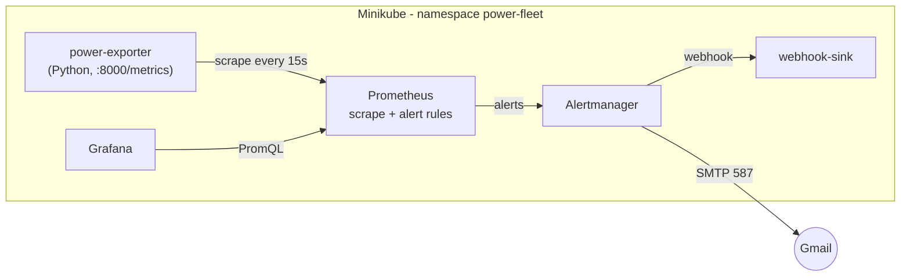

The exporter reads from a pluggable source, selected with `POWER_SOURCE`:

- `simulated` (default): in-process fleet with injectable scenarios.
- `hmc`: documented skeleton in [`exporter/sources/hmc.py`](exporter/sources/hmc.py) for a real lab.

More detail: [`docs/architecture.md`](docs/architecture.md).

---

## Quick Start

### Prerequisites

- Docker, Minikube and kubectl
- `bash` (Git Bash or WSL on Windows)
- Python 3.12 only for running the tests locally

### 1. Deploy everything

```bash
bash scripts/demo.sh
```

The script:
1. Starts Minikube if it is not running.
2. Builds the exporter image and loads it into Minikube (`minikube image load`).
3. Applies the manifests and creates the `prometheus-rules` and `grafana-dashboards` ConfigMaps from the single-source files.
4. Waits for all deployments and prints the access URLs.

### 2. Open the services

| Service | URL (`<IP>` = `minikube ip`) | Credentials |
|---------|------------------------------|-------------|
| Grafana | `http://<IP>:30030` | `admin` / `admin` |
| Prometheus | `http://<IP>:30090` | none |
| Alertmanager | `http://<IP>:30093` | none |
| Exporter | `kubectl port-forward -n power-fleet svc/power-exporter 8000:8000`, then `http://localhost:8000/metrics` | none |

> With the Docker driver on Windows or macOS the node IP is not reachable from the host. Run `minikube service grafana -n power-fleet --url` (one terminal per service, leave it open) and use the printed `127.0.0.1` URL.

### 3. Inject a fault scenario

```bash
bash scripts/inject_scenario.sh cpu_saturation
bash scripts/inject_scenario.sh clear          # back to baseline
```

### 4. Tear down

```bash
bash scripts/demo.sh --teardown
```

---

## Fault Scenarios

| Scenario | Effect | Alerts that fire (verified on Minikube) |
|----------|--------|------------------------------------------|
| `cpu_saturation` | `lpar-db2-01` CPU ~98 % | `LparHighCpu`, `LparCriticalCpu` |
| `memory_leak` | `lpar-app-01` memory grows ~6 GB/min from activation | `LparHighMemory` (after ~9 min) |
| `lpar_down` | `lpar-web-01` becomes *Not Activated* | `LparDown` |
| `frame_overcommit` | `frame01` allocated cores at 115 % of physical | `FrameOvercommit`, `FrameHighOvercommit` |
| `vios_disk_latency` | `vios-01a/b` disk latency ~180 ms | `ViosHighDiskLatency`, `ViosCriticalDiskLatency` |
| `hmc_unreachable` | `power_source_healthy` = 0 | `PowerSourceUnhealthy` |

`ViosDown` and `ExporterDown` are also defined. `ExporterDown` can be triggered with `kubectl scale deploy/power-exporter -n power-fleet --replicas=0`.

---

## Evidence (screenshots)

All captured on Minikube running this repository.

### Baseline

**Grafana dashboard, healthy fleet**

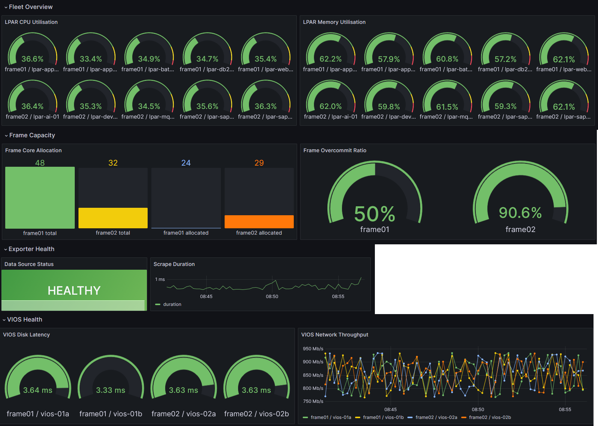

**Prometheus targets**

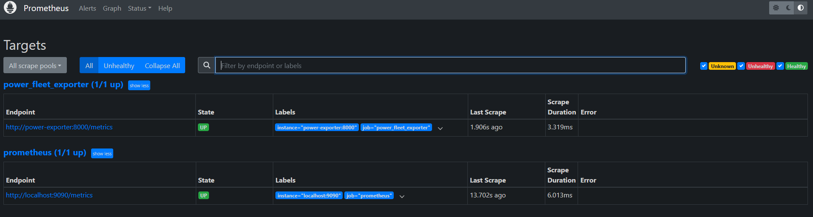

**Prometheus alert rules (all groups healthy)**

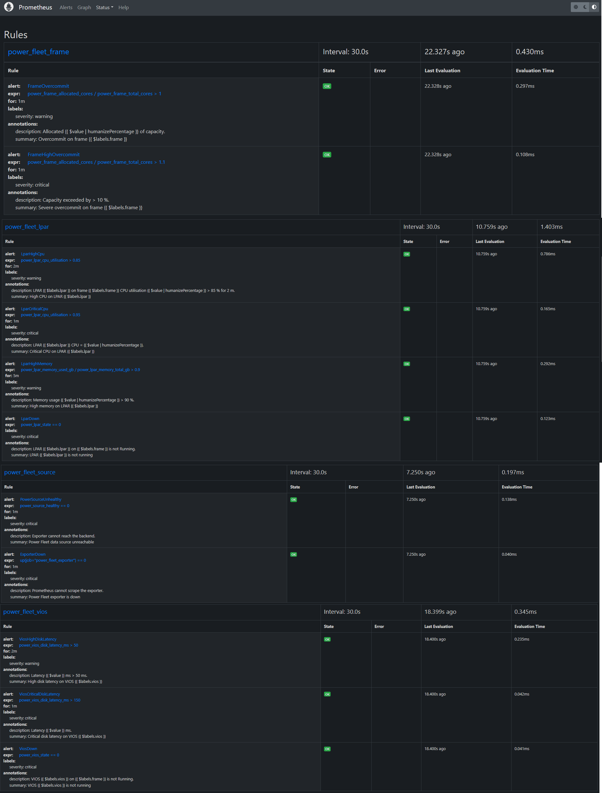

**Exporter `/metrics` endpoint**

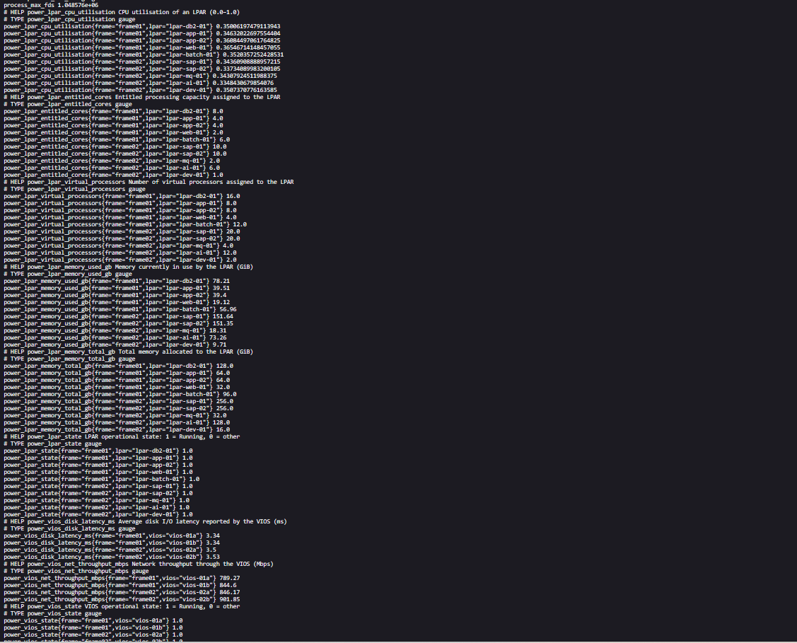

**Pods in the `power-fleet` namespace**

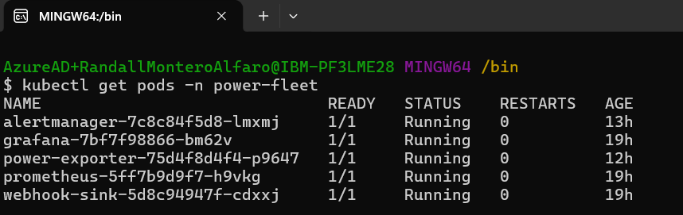

### Incident: `cpu_saturation`

**Grafana: `lpar-db2-01` saturated**

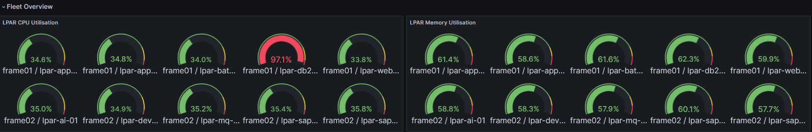

**Prometheus alerts firing**

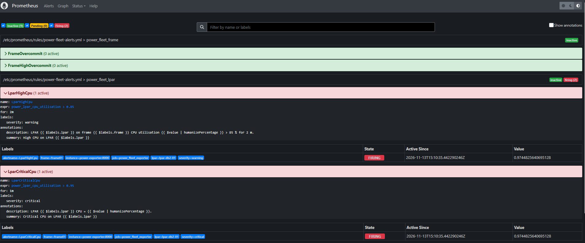

**Alertmanager routing to `gmail` and `webhook-backup`**

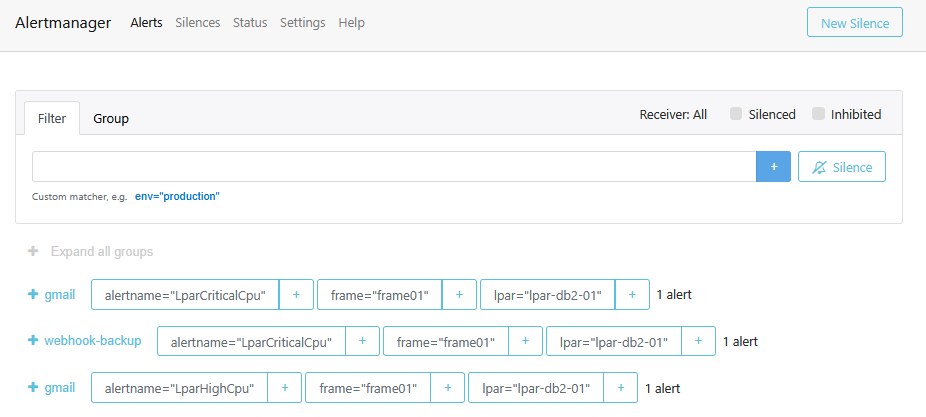

**Webhook receiver log**

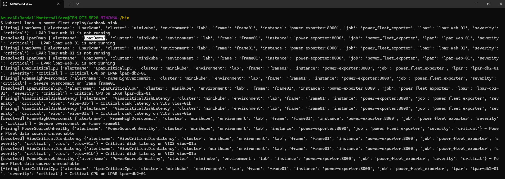

### Notifications (Gmail SMTP)

**Firing**

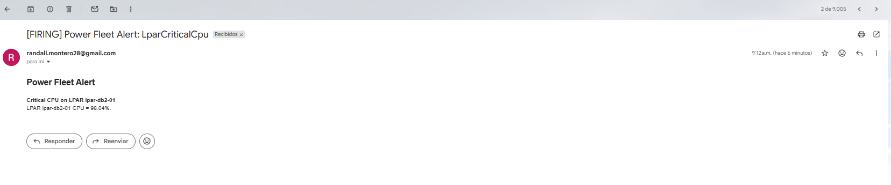

**Resolved**

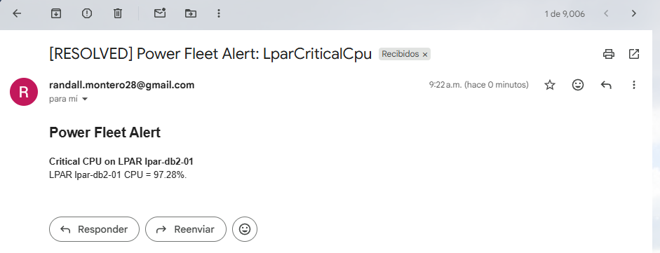

---

## Project Structure

```
power-fleet-observability/
├── exporter/
│   ├── app.py                    # Prometheus exporter entrypoint
│   ├── requirements.txt
│   ├── sources/
│   │   ├── base.py               # Abstract PowerSource + dataclasses
│   │   ├── simulated.py          # Simulated fleet + fault scenarios (default)
│   │   └── hmc.py                # HMC REST skeleton (lab extension)
│   └── tests/
│       ├── test_simulated.py     # topology + scenarios
│       └── test_app.py           # published gauges
├── k8s/
│   ├── namespace.yaml
│   ├── exporter.yaml
│   ├── prometheus-config.yaml    # scrape config
│   ├── prometheus.yaml           # Prometheus Deployment/Service
│   ├── alertmanager.yaml         # routing: Gmail SMTP + webhook
│   ├── webhook-sink.yaml         # backup webhook receiver (logs alerts)
│   └── grafana.yaml              # Grafana + datasource provisioning
├── monitoring/rules/
│   └── power-fleet-alerts.yml    # alert rules (single source, also linted in CI)
├── grafana/dashboards/
│   └── power-fleet.json          # dashboard (single source, loaded by demo.sh)
├── helm/power-fleet-observability/   # Helm chart (exporter only)
├── scripts/
│   ├── demo.sh                   # deploy everything on Minikube
│   ├── inject_scenario.sh        # inject / clear a fault scenario
│   └── create_gmail_secret.sh    # store the Gmail App Password as a Secret
├── docs/
│   ├── architecture.md
│   └── screenshots/              # evidence
├── .github/workflows/ci.yml      # pytest, promtool, helm lint, docker build
├── Dockerfile
├── pyproject.toml
├── LICENSE.md
├── CONTRIBUTING.md
└── README.md
```

`demo.sh` builds the `prometheus-rules` and `grafana-dashboards` ConfigMaps from the two single-source files, so what CI lints is exactly what runs in the cluster.

---

## Running Tests Locally

```bash
pip install -r exporter/requirements.txt pytest
pytest exporter/tests -v
```

---

## Helm Chart (exporter only)

The chart in [`helm/power-fleet-observability`](helm/power-fleet-observability) packages **only the exporter** (Deployment + Service) as an Infrastructure-as-Code example. Prometheus, Grafana, Alertmanager and the webhook sink are deployed with the manifests in `k8s/` through `scripts/demo.sh`.

```bash
helm lint helm/power-fleet-observability

# Install the exporter (the image must already be loaded into Minikube)
helm install power-fleet helm/power-fleet-observability \
  --namespace power-fleet --create-namespace

# Inject a scenario through values
helm upgrade power-fleet helm/power-fleet-observability \
  --namespace power-fleet --set exporter.scenario=cpu_saturation

helm uninstall power-fleet -n power-fleet
```

Do not combine `helm install` with `demo.sh` in the same namespace: both own the `power-exporter` Deployment.

---

## Gmail Alerting Setup

1. Enable 2-Factor Authentication on the Gmail account.
2. Generate an [App Password](https://myaccount.google.com/apppasswords).
3. Edit `smtp_from`, `smtp_auth_username` and the `to:` address in [`k8s/alertmanager.yaml`](k8s/alertmanager.yaml), then apply it:

```bash
kubectl apply -f k8s/alertmanager.yaml
```

4. Store the password as a Kubernetes Secret (input is hidden; nothing is written to disk or Git):

```bash
bash scripts/create_gmail_secret.sh
```

`demo.sh` creates a placeholder Secret only if none exists, so re-running it never overwrites your real password.

Until the Secret holds a real password, Gmail notifications fail with `535 Username and Password not accepted`. The webhook receiver keeps working: `kubectl logs -n power-fleet deploy/webhook-sink`.

---

## HMC Extension (Lab)

Set `POWER_SOURCE=hmc` and implement `HmcSource.collect()` in [`exporter/sources/hmc.py`](exporter/sources/hmc.py). The skeleton documents the HMC REST flow step by step.

---

## Notes

- Grafana uses `admin` / `admin` for this lab. Change `GF_SECURITY_ADMIN_PASSWORD` in [`k8s/grafana.yaml`](k8s/grafana.yaml) for anything beyond a local demo.
- The Gmail App Password is never stored in the repository.
- Prometheus scrapes the exporter through a static target (`power-exporter:8000`), resolved by Kubernetes DNS through the Service.

---

## License

Apache 2.0, see [LICENSE.md](LICENSE.md).
